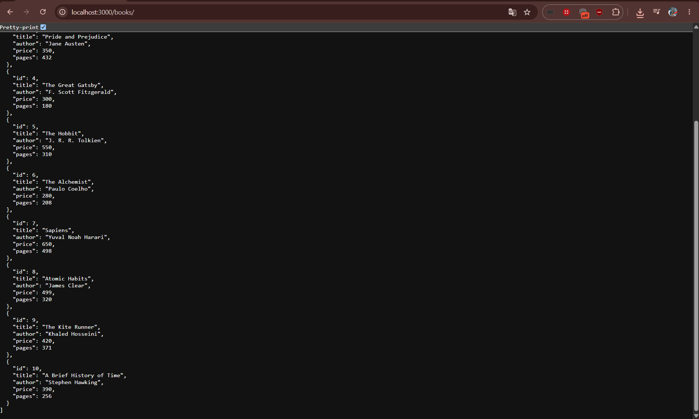
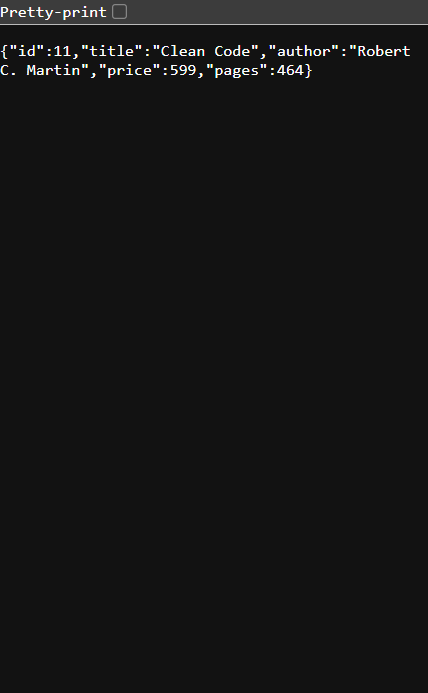

# Lab 2: SQLite database and CRUD routes

**Name:** Your name  
**Registration number:** Your registration number  
**Section:** Your section  
**Live link:** Not deployed yet. This SQLite-backed server needs a deployment service with persistent disk storage.

## Objective

Connect an Express server to a SQLite database and expose CRUD operations over HTTP.

## How to run

Requirements: Node.js 18, 20, or 22 and npm. No environment variables are required. Optional variables are `PORT` (defaults to `3000`) and `DATABASE_PATH` (defaults to `books.db`).

```bash
npm install
npm run seed
npm run dev
```

`npm run dev` starts the app with nodemon. Open `http://localhost:3000/books/` after it starts.

### SQLite CLI alternative

The supplied `npm run seed` creates the 10 sample rows. To create the same rows using the SQLite CLI instead, run the following from this folder:

```bash
sqlite3 books.db
.read schema-and-seed.sql
.headers on
.mode column
SELECT * FROM book;
```

## Endpoints

| Method | Path | Description |
| --- | --- | --- |
| GET | `/books/` | Returns every book. |
| GET | `/books/:bookId/` | Returns one book or `404` when it does not exist. |
| POST | `/books/` | Adds a book and returns it with `201 Created`. |
| PUT | `/books/:bookId/` | Replaces a book’s title, author, price, and pages. |
| DELETE | `/books/:bookId/` | Removes a book and returns `204 No Content`. |

For POST and PUT, send this JSON body:

```json
{
  "title": "Clean Code",
  "author": "Robert C. Martin",
  "price": 599,
  "pages": 464
}
```

All user-supplied SQL values use `?` placeholders, so the database driver binds the data separately from the SQL statement. This protects the routes against SQL injection.

## Screenshots

Import `postman/Lab-02-Books.postman_collection.json` into Postman. Run the requests in order, take the five screenshots below, and save them with these names before submission.





## Notes

The database connection is awaited inside `initializeDBAndServer()` so the server does not start before SQLite is ready. `POST` creates a resource, while `PUT` replaces an existing resource at a known URL.
